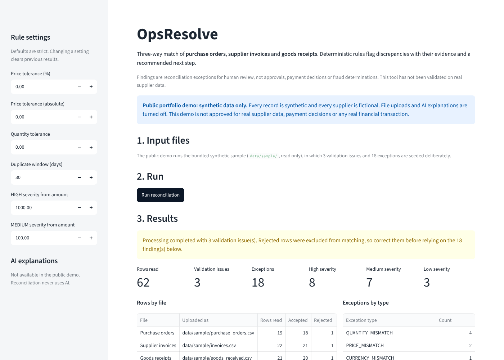
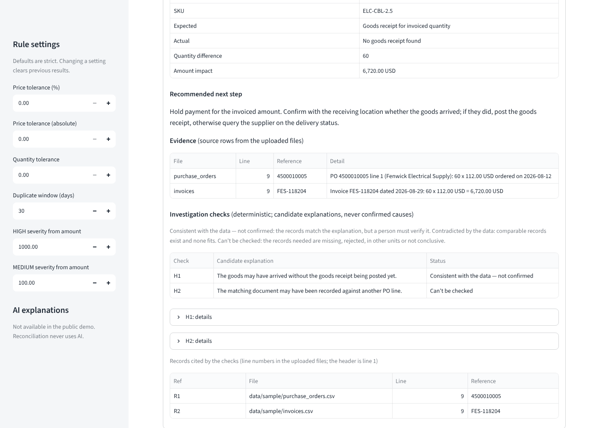
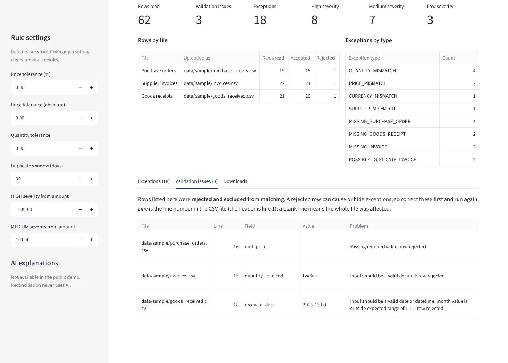
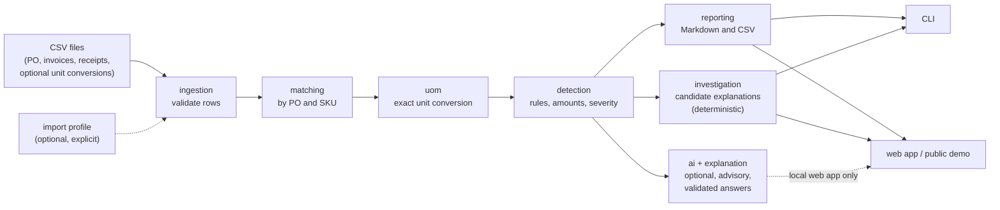

# OpsResolve AI

[](https://github.com/garvit-mittal04/opsresolve-ai/actions/workflows/ci.yml)

Operations exception investigator for manufacturing and distribution businesses. OpsResolve finds
discrepancies between **purchase orders**, **supplier invoices** and **goods-received records**, quantifies
them exactly, shows the evidence and recommends a next step. Optional, advisory AI explanations sit on top of
the deterministic engine; they never calculate anything.

> **Status: portfolio project.** A deterministic Python engine with a CLI, a local web app and a
> [public demo mode](#public-demo-mode). All matching and financial calculations are rule-based Python using
> exact decimal arithmetic; no LLM is used for them. An optional, separately installed module can ask an AI
> model to explain one exception from its evidence (advisory only, see
> [AI explanations](#ai-explanations-optional)); the local web app offers it per finding, off by default, and
> the public demo never offers it. Deterministic [investigation checks](#investigation-checks) list candidate
> explanations for a finding and test each against the loaded records; they are never confirmed causes.
> **All data is synthetic and all suppliers are fictional; the tool has not been validated on real customer
> or supplier data and is not approved for real financial transactions.**

**Public demo:** not deployed yet. The demo runs only the bundled synthetic sample, with uploads and AI
turned off; see [Deploying the public demo](#deploying-the-public-demo). Its link will be added here once it
has been deployed and checked at its public address.

## Screenshots

Taken from the public-demo mode running locally
(`streamlit run demo/streamlit_app.py --server.address localhost`) on the bundled synthetic sample, in a
1400-pixel-wide browser window.

| Run summary | One finding with its investigation checks | Rejected input rows |
|---|---|---|
|  |  |  |

## Highlights

- **Exact, explainable arithmetic.** Every quantity and amount is a `Decimal`, rounded half-up to cents only
  at the edge; every finding lists the source rows (file and line) it was computed from.
- **Strict input handling.** Invalid rows are rejected and reported by file, line and field, never repaired or
  guessed. Other CSV layouts are read only through an explicitly selected [import profile](#import-profiles).
- **Nine exception types** (quantity, price, currency, supplier and unit-of-measure mismatches; missing PO,
  goods receipt or invoice; possible duplicate invoices) with severity, amount impact and a recommended
  next step that never asserts a cause.
- **Investigation checks** that test candidate explanations from a fixed catalogue against the records and
  label each "consistent with the data — not confirmed", "contradicted by the data" or "can't be checked".
- **Measured against a labelled synthetic benchmark** (36 scenarios, hand-written answer key): precision
  1.000, recall 0.973, F1 0.986, with the one miss (S36) documented as a known limitation.
- **Safe exports:** web downloads and the CLI's `investigations.csv` neutralise spreadsheet formulas.
- **1,152 automated tests** (1,141 run without the optional AI SDK), including Streamlit UI tests and the
  public-demo restrictions; see [Test evidence](#test-evidence).

## Architecture at a glance



Business rules live only in the pure engine modules; the CLI, the web app and the public demo are thin layers
over the same pipeline, so the same files and settings give the same findings everywhere. See
[`docs/architecture.md`](docs/architecture.md) for the module boundaries and the full rule table.

## Limitations at a glance

- **Synthetic data only.** No real supplier data has been processed and no customer has validated the
  output. The benchmark was written by the same team as the rules; it is not evidence of real-world accuracy.
- **Known miss (S36):** a duplicate bill re-sent under a new number on a half-delivered PO is not flagged,
  because its records are indistinguishable from a legitimate second invoice (S27).
- **No currency conversion,** and no rules for tax, freight, discounts, credit notes, returns, PO amendments
  or invoice header totals.
- **Placeholder business thresholds:** the default tolerances (zero) and severity thresholds (1,000.00 and
  100.00) are not tuned to any business.
- **Live AI behaviour is untested:** no test calls the real API and the quality of real model answers has not
  been evaluated. The public demo has no AI at all.
- **Single user, no persistence:** no login, sharing, saved runs or exception-status tracking. The public demo
  is a read-only showcase of the synthetic sample, not a hosted service for your data.

More detail: [Evaluation](#evaluation), [Web app limitations](#web-app-limitations) and
[`docs/validation-plan.md`](docs/validation-plan.md).

## What it does

1. Loads `purchase_orders.csv`, `invoices.csv` and `goods_received.csv`, plus an optional per-SKU
   `uom_conversions.csv`. Files in other layouts (another delimiter, encoding, date or number format, or
   column names) can be read with an explicitly selected [import profile](#import-profiles).
2. Validates every row (required fields, numbers, ISO dates, currency codes, unit codes, key uniqueness)
   and reports problems by file, line and field. Invalid rows are excluded, never guessed at.
3. Matches invoices and receipts to PO lines by `(po_number, sku)`.
4. Normalises units of measure: where documents state units, quantities and prices are converted to the
   PO line's unit using only the per-SKU conversions supplied, and only when the result is exact
   (see [Units of measure](#units-of-measure-optional)).
5. Detects: quantity mismatches (billed vs received, over-receipt), price mismatches, currency,
   supplier and unit-of-measure mismatches, missing PO / goods receipt / invoice, and possible
   duplicate invoices (judged against the PO's ordered and received quantities).
6. Calculates quantity differences and amount impact exactly.
7. Writes a readable Markdown report plus CSV exports, ordered by severity, from the CLI or from the
   [local web app](#local-web-app), which also lets you filter and inspect findings in a browser.
8. Optionally checks candidate explanations for each finding against the loaded records
   ([investigation checks](#investigation-checks)): shown in the web app and, on request, written by the CLI
   to `investigations.csv`. They never change a finding and are never presented as confirmed causes.

See [`docs/architecture.md`](docs/architecture.md) for the rule table and
[`docs/validation-plan.md`](docs/validation-plan.md) for how correctness is tested.

## Setup

Requires Python 3.10+.

```bash
git clone https://github.com/garvit-mittal04/opsresolve-ai.git
cd opsresolve-ai
python -m venv .venv
source .venv/bin/activate          # Windows: .venv\Scripts\activate
pip install -e ".[dev,app]"        # engine + tests + web app (Streamlit)
```

The `app` extra adds Streamlit for the web app and its UI tests. `pip install -e ".[dev]"` installs only the
engine, CLI and test tools; with it, `pytest` skips the Streamlit UI tests (reported as skipped in its summary).
The optional `ai` extra (`pip install -e ".[dev,app,ai]"`) adds the Anthropic SDK for
[AI explanations](#ai-explanations-optional); without it, the tests against the real SDK are skipped.

## Run

```bash
# Run on the bundled synthetic data (data/sample) and write reports/
python -m opsresolve

# Your own files
python -m opsresolve --data-dir path/to/folder --output-dir out/
python -m opsresolve --purchase-orders po.csv --invoices inv.csv --goods-received grn.csv

# Exit with status 1 if any exception or validation issue is found (for scheduled jobs)
python -m opsresolve --fail-on-exceptions

# Files exported in another layout, read with an import profile (see "Import profiles")
python -m opsresolve --data-dir path/to/export --profile docs/examples/import-profile-example.json

# Also write investigations.csv (see "Investigation checks"); the other files are the same either way
python -m opsresolve --with-investigations
```

Outputs (in `reports/` by default, git-ignored):

| File | Contents |
|---|---|
| `exception_report.md` | Input summary, validation issues, exception summary, and each exception with evidence and recommended action |
| `exceptions.csv` | One row per exception |
| `validation_issues.csv` | One row per rejected field/row |
| `investigations.csv` | Only with `--with-investigations`: one row per investigation check (see [Investigation checks](#investigation-checks)) |

The installed console script `opsresolve` is equivalent to `python -m opsresolve`. Exit status: 0 on success,
1 with `--fail-on-exceptions` when anything is found, 2 for invalid configuration or an invalid import
profile, and 3 when `--with-investigations` was given but the checks could not be prepared (the other report
files are then complete and `investigations.csv` is not written). Exit status 3 takes precedence over 1: with
`--fail-on-exceptions`, a run that finds exceptions and cannot prepare the checks exits 3.

## Local web app

A single-page Streamlit app for running a reconciliation from your browser, reviewing the findings and
exporting them. It runs **only on your computer**: started as below it listens on `localhost` only, and it
refuses to run (showing only the launch command) when the server is bound to any other address. It sends no
usage statistics and uses no database, cloud service or AI model unless you turn on the optional AI
explanations. It calls the same pipeline as the CLI, so results are identical for the same files and settings.

### Install and launch (macOS)

```bash
cd opsresolve-ai
python3 -m venv .venv
source .venv/bin/activate
pip install -e ".[app]"            # adds Streamlit; use ".[dev,app]" to also run the tests
streamlit run app.py --server.address localhost
# or: python -m streamlit run app.py --server.address localhost
```

Launch from the repository root. `--server.address localhost` keeps the server on this computer: the
repository's single `.streamlit/config.toml` is shared with the hosted public demo, so it sets no server
address (see [Public demo mode](#public-demo-mode)). Without the option, or with any address other than
`localhost`, `127.0.0.1` or `::1`, the app shows only an error with the command above and offers no upload.
The config file still turns off usage statistics, keeps cross-site request forgery protection on and limits
uploads to 20 MB; command-line flags or `STREAMLIT_*` environment variables that you set yourself override it.
It opens `http://localhost:8501` in your browser; stop it with `Ctrl+C` in the terminal.

### Performing a reconciliation

1. **Input files.** Upload the three required CSVs (purchase orders, invoices, goods receipts) and,
   if your documents state units of measure, the optional unit-conversion file. Each uploader has an
   *Expected format* panel listing the required and optional columns (see [Input format](#input-format))
   and a template download with example rows. To try it out, choose **Use bundled sample data**.
   If your files use another layout, also upload an **Import profile (optional, .json)** below the four
   file uploaders (see [Import profiles](#import-profiles)). A valid profile is confirmed with its name and
   a short hash; an invalid one lists its problems in a table and the Run button stays disabled until you
   fix or remove it. The *What is an import profile?* panel offers the example profile as a download.
   Profiles are not used with the bundled sample data.
2. **Rule settings** (sidebar). Tolerances, duplicate window and severity thresholds. Defaults are strict,
   or come from `OPSRESOLVE_*` environment variables as for the CLI.
3. **Run reconciliation.** The button is enabled once all required files are present (and any uploaded
   import profile is valid).

### Reviewing and exporting findings

- **Summary:** rows read per file (accepted and rejected), the number of validation issues and
  exceptions, counts by severity and type, and a processing status. "No exceptions" means the documents
  agree under the current rules; it is not an approval or payment decision.
- **Exceptions:** filter by severity and type, search by PO, SKU, supplier, invoice or GRN number, and
  inspect one finding: expected vs actual, amount impact, recommended next step, the evidence rows
  (with CSV line numbers) and every note from the engine. Possible duplicates are alerts for human
  review, not confirmed duplicates. The finding's [investigation checks](#investigation-checks) follow:
  each candidate explanation with its status, the observations behind it, what is needed to decide, how to
  confirm it, and the cited records (file and line).
- **Validation issues:** shown separately, with the uploaded file name, line, field, value and problem.
  These rows were rejected and excluded from matching; correct them before relying on the findings.
- **Downloads:** exceptions CSV, validation-issues CSV and the Markdown summary report, generated from
  the current run. In the CSV downloads, cells that would start a spreadsheet formula (`=`, `+`, `-`, `@`,
  tab, carriage return) are prefixed with `'` so spreadsheets show them as text; plain numbers such as
  `-50.00` are unchanged. (The CLI's report files are not altered.)

Changing any upload (including adding, changing or removing an import profile) or setting clears the
previous results, so what you see always matches the current inputs. When a profile was used, the results
start with `Import profile: <name> (sha256 <first 12 hex characters>)`.

### Data handling

Uploaded files are written under fixed names (never their uploaded names) to a temporary folder that is
deleted as soon as the run finishes, including when it fails. Results are kept only in memory for your
browser session; there is no upload history. Streamlit itself holds uploaded files in memory until you
remove them or close the tab. Uploads are limited to 20 MB and `.csv` files (`.json` for the import
profile, which is read in memory and never written to disk; the profile limit is 65,536 bytes (64 KiB),
inclusive, and a larger profile is rejected with the problem listed in the app).

### Web app limitations

- Same engine limitations as the CLI (see [Evaluation](#evaluation) and the roadmap below); **the app
  has not been validated on real supplier data**, and its findings need human review.
- Single user, local only: no login, sharing, saved runs or status tracking of exceptions.
- Files must use the column names above unless an import profile maps them; there is no automatic
  detection of layouts.
- Verified versions (on Linux): the full test suite passes with Streamlit 1.65 on Python 3.10, 3.13 and 3.14,
  and with Streamlit 1.66.0 on Python 3.12 and 3.13 (the versions pinned in `requirements.txt` for the public
  demo). CI installs the newest Streamlit release on Python 3.10 and 3.14.
  With Streamlit 1.50, the declared minimum, the app was only smoke-tested in a browser (upload, run,
  CSV download) on Python 3.13 during Milestone 6, when 17 UI tests failed there because Streamlit 1.50's
  test tool (`AppTest`) has a smaller API (no file-upload or download-button support, and dropdowns can
  only be set by value). The import-profile UI has not been tested with Streamlit 1.50. CI runs on Linux only.

## Public demo mode

`demo/streamlit_app.py` runs the same page as `app.py` in a restricted mode meant for a public portfolio
deployment:

- **Only the bundled synthetic sample.** Visitors run `data/sample/` (read only) and explore the results,
  filters, finding details, investigation checks and downloads. There is no data-source choice.
- **No uploads.** No upload widget of any kind is created (data files, import profile, templates).
- **No AI.** The AI section is replaced by a fixed note. AI readiness is never checked, so a key set in the
  environment or in hosting secrets is never read, and no request can be made.
- **A clear notice** that the data is synthetic, suppliers are fictional, and the demo is not approved for
  real supplier data, payment decisions or any real financial transaction.
- **One session per visitor.** Results, settings and filters live in Streamlit's per-browser-session state;
  the app keeps no module-level or cached state and writes nothing to disk except the per-run temporary
  folder, which is deleted when the run ends. Nothing is shared between visitors.
- **No error details** (tracebacks or file paths) are shown to visitors: demo mode sets Streamlit's
  `client.showErrorDetails` to `none` from the code, one of the options Streamlit allows a script to set.

Everything else is the local app unchanged: `streamlit run app.py --server.address localhost` still offers
uploads, import profiles and optional AI explanations.

Run the demo locally, bound to this computer:

```bash
pip install -e ".[app]"
streamlit run demo/streamlit_app.py --server.address localhost
```

**Configuration strategy.** Streamlit Community Cloud reads one `.streamlit/config.toml`, at the repository root,
whatever the entrypoint, and runs apps from the root. So the repository has exactly that one file, and it
holds only settings that are right for both uses (no usage statistics, XSRF protection, the 20 MB upload limit,
the theme). It does not set the server address: the hosting platform binds the demo as it needs, and every
local launch command binds to localhost explicitly. Settings that differ between the demo and the local app
are made in code by `app.main(public_demo=True)`, not by a second config file.

## Deploying the public demo

The demo is designed for [Streamlit Community Cloud](https://docs.streamlit.io/deploy/streamlit-community-cloud).
It needs no database, authentication, secrets or API key. **It has not been deployed yet**; the steps below
describe the intended configuration and the checks to run once it is live.

1. Push the repository (including `requirements.txt`, `demo/` and `data/sample/`) to GitHub.
2. In Community Cloud choose **Create app**, select the repository and branch, and set the **main file path**
   to `demo/streamlit_app.py`. Do not deploy `app.py`: it accepts uploads.
3. Under **Advanced settings**, choose **Python 3.13** (the version the full suite was run with for these pins;
   3.12 also passes) and leave **Secrets empty**. The demo never reads `ANTHROPIC_API_KEY`, but there is no
   reason to store one there.
4. Deploy. Community Cloud installs `requirements.txt` from the repository root, the one dependency file it
   uses here: `-e .[app]` installs the project and its `app` extra as declared in `pyproject.toml` (editable,
   because the bundled sample is found next to the source tree, which a regular install would not include),
   and the pins fix Streamlit, pandas and pydantic to the tested versions within `pyproject.toml`'s ranges
   (tests check this). Because `requirements.txt` comes before `pyproject.toml` in Community Cloud's order,
   `pyproject.toml` is read only as the project's metadata, not as a separate dependency file; the demo
   folder has no dependency file of its own. Do not delete `requirements.txt`: Community Cloud would then
   treat `pyproject.toml` as a Poetry project, which this setuptools project is not.
5. Check the live app at its public address before sharing it:
   - the synthetic-data notice is shown and the sidebar says AI explanations are not available;
   - there is no upload control anywhere on the page;
   - **Run reconciliation** shows 62 rows read, 3 validation issues and 18 exceptions (8 high, 7 medium, 3 low);
   - a finding's detail panel shows its investigation checks and no AI section;
   - the three downloads work, and in the exceptions CSV the amount `-50.00` is a plain number;
   - opening the app in a second browser (or a private window) shows no results until you run it there.
6. Add the public link to the top of this README.

What the platform documentation says, and how this repository follows it:

- Community Cloud runs every app from the repository root and recognises one `.streamlit/config.toml`, at the
  root, even for an entrypoint in a subdirectory
  ([file organization](https://docs.streamlit.io/deploy/streamlit-community-cloud/deploy-your-app/file-organization)).
  The repository has only that file, and it sets no server address.
- It uses the first dependency file it finds, in the entrypoint's folder and then the root, in the order
  `uv.lock`, `requirements.txt`, `pyproject.toml` (Poetry), and advises using only one
  ([app dependencies](https://docs.streamlit.io/deploy/streamlit-community-cloud/deploy-your-app/app-dependencies)).
  `requirements.txt` at the root is the one used; tests check that no other dependency file competes with it.
- The Python version is chosen when deploying and cannot be changed later without redeploying
  ([upgrade Python](https://docs.streamlit.io/deploy/streamlit-community-cloud/manage-your-app/upgrade-python)).
- Secrets are entered in the app's settings, never committed
  ([secrets management](https://docs.streamlit.io/deploy/streamlit-community-cloud/deploy-your-app/secrets-management));
  the demo needs none.

Still to confirm on the first deployment, because the documentation does not say: how the platform binds the
server (the demo runs with any address, so this should not matter), and that installing an editable project
with an extra (`-e .[app]`) from `requirements.txt` works there as it does with uv and pip locally.

**Security limitations of the public demo.** It is a read-only showcase, not a hardened service: it has no
login, rate limiting or audit log, and it relies on the hosting platform for HTTPS, isolation between apps and
availability (Community Cloud apps go to sleep when unused). Anyone with the link can use it. It must never
be changed to accept uploads or enable AI without a separate security review.

## Configuration

Tolerances and severity thresholds come from `OPSRESOLVE_*` environment variables; defaults are
strict (zero tolerance). See [`.env.example`](.env.example). The variables are read from the
process environment; to use a `.env` file in bash:

```bash
cp .env.example .env
set -a; source .env; set +a
python -m opsresolve
```

No API keys or secrets are needed for reconciliation. Only the optional AI explanations need
`ANTHROPIC_API_KEY` (see below). Never commit `.env`.

## AI explanations (optional)

`opsresolve.ai.explain_exception(result, exception)` asks an Anthropic model to explain one exception in
plain language: what differs, which evidence shows it, unverified possible causes and how to check them,
and what information is missing. It needs `pip install -e ".[ai]"` and `ANTHROPIC_API_KEY`; without
either it returns `not_configured` and sends nothing. Model, effort, timeout, retries and output size come
from `OPSRESOLVE_AI_*` variables (see [`.env.example`](.env.example)).

- **Advisory only.** The model never calculates or changes an amount or an exception; every figure stays
  the engine's. Each answer is checked by a deterministic validator (citations, identifiers, dates,
  numbers, signs, direction, codes, supplier names, sufficiency) and is returned only if it passes;
  otherwise the result is `rejected` with the problems found. Passing does not make it true: a person
  must review every explanation.
- **What is sent.** One exception's evidence: the engine's facts and text, and for each evidence row its
  document number, PO line, SKU, quantities, prices, currency, dates, units and line amounts. Supplier
  ids are replaced by pseudonyms and supplier names and item descriptions are never sent, but this is
  still business data and is not anonymous. If any known supplier id or name is still in the request,
  nothing is sent. `opsresolve.ai.preview_request(...)` shows the exact request body;
  `TRANSMITTED_FIELDS` and the module docstring list every field. Requests go only to
  `https://api.anthropic.com` (`ANTHROPIC_BASE_URL` is ignored).
- **Failures** (missing configuration, authentication, rate limits, timeouts, network, refusals,
  malformed answers, unexpected provider errors, the privacy check) are returned as results with a code;
  logs hold no key, prompt, evidence, names or answers. While a request is made, debug and info records of
  the Anthropic SDK and its HTTP libraries (which can hold the request body and headers) are dropped for that
  request's thread, even with `ANTHROPIC_LOG=debug`; their warnings and errors, other threads and other code
  log as configured. Automated tests never call the API.

**In the web app** (`streamlit run app.py --server.address localhost`): turn on *Enable AI explanations* in the
sidebar; the page shows whether the SDK and `ANTHROPIC_API_KEY` are available. In a finding's detail panel you
can show the exact request (pseudonymised, as code) and press *Send to Anthropic for an explanation*; nothing is
sent on page load, on preview or for any other finding. The answer is shown as plain text and tables, labelled
as AI-generated and advisory; it never changes the findings, amounts or downloads. A rejected answer shows only
problem codes and field names; failures show fixed messages. In the web app a request is given up after 120
seconds and not retried, unless `OPSRESOLVE_AI_TIMEOUT_SECONDS` or `OPSRESOLVE_AI_MAX_RETRIES` is set. The send
button is disabled while a request for that finding runs, so one finding has at most one request at a time.
Explanations are kept in memory for the current run only and are not saved.

## Investigation checks

For some findings, OpsResolve lists **candidate explanations** from a fixed, reviewed catalogue and checks
each one deterministically (exact `Decimal` comparisons, no AI, no network) against the records of the loaded
files. A candidate explanation is a hypothesis to investigate, **never a confirmed root cause**: the checks do
not change any finding, amount, severity, ID, recommended action or default report.

Each check gets one of three evidence statuses:

| Status | Meaning |
|---|---|
| Consistent with the data — not confirmed | The loaded records match what the explanation would produce. A person must verify it; several explanations can be consistent at once. When several records fit, all are cited and the check says the match is not unique. |
| Contradicted by the data | Comparable, complete records exist and none of them fits. |
| Can't be checked | The records needed are missing, were (or may have been) rejected during validation, are in another or unstated unit, or cannot rule the explanation out. The check says what would be needed. |

**Check failed — nothing concluded** is not an evidence status: the check itself hit an error (a defect).
Only that fixed label is shown, never the error's type or message; the other checks still run.

| Check | Applies to | Consistent when |
|---|---|---|
| Receipt not posted | Billed more than received; missing goods receipt | Invoiced quantity is within the ordered quantity. Never "contradicted": above the ordered quantity it can't be checked, since an unposted delivery above the order cannot be ruled out from the records alone |
| Unit mix-up | Quantity mismatches (billed or over-receipt); price mismatches | The two totals (or prices) differ exactly by a per-SKU conversion factor, or converting exactly one document by that factor makes them equal. Needs a conversion row for the SKU |
| Mistyped PO number | Missing purchase order (an invoice or receipt citing an unknown PO) | A PO line of the same supplier and SKU has a number that is equal ignoring letter case, separators and leading zeros of digit groups, or differs by one character or by two swapped adjacent characters |
| Document under another PO | Missing goods receipt; missing invoice; over-receipt | Another document of the same supplier and SKU has exactly the needed quantity (a receipt of the invoiced quantity, an invoice of the received quantity), or another PO line has exactly the excess still open |
| Price from another order | Price mismatch | Another PO line of the same supplier, SKU, currency and unit has exactly the invoice's unit price |

Other finding types (supplier, currency and unit-of-measure mismatches, possible duplicates) have no checks.

**Evidence references.** Within one finding, checks are numbered H1, H2, … and every cited record R1, R2, …
with its file, line in the uploaded CSV (the header is line 1) and document number. Every observation cites
the records it relies on, including records outside the finding's own evidence, such as another PO line.

**Where to see them.** In the web app, in each finding's detail panel (computed once per run and recomputed
whenever inputs, settings or the run change). From the CLI, `--with-investigations` writes `investigations.csv`
next to the other reports: one row per check (`exception_id`, `exception_type`, `po_number`, `sku`, `check_id`,
`check`, `candidate_explanation`, `status`, `status_label`, `observations`, `needed_to_decide`, `how_to_confirm`,
`records`), or one row for a finding with no checks. **Unlike the CLI's other CSV files, every cell of
`investigations.csv` is protected against spreadsheet formulas**: text starting with `=`, `+`, `-`, `@`, a tab or
a carriage return gets a leading `'` (plain numbers such as `-50.00` are unchanged), the same rule as the web
app's downloads. The other CLI files are written exactly as before.

**Limitations.**

- Matching is strict and exact: the same supplier and SKU, exact quantities and prices, and quantities or
  prices of different PO lines only in the same unit (or with no unit stated on either). Records in another
  unit are never converted, only excluded, so a real match in another unit gives "can't be checked".
- A unit mix-up on some, but not all, of several invoices or receipts of one PO line gives "can't be checked".
- Conservative handling of rejected rows: a rejected row whose PO number or SKU could not be read, or a
  file-level problem, makes the affected checks "can't be checked" for that file.
- Currency differences are not treated as unit differences: other orders in another currency are not compared.
- "Consistent" means only that the loaded records fit. Missing or late documents (for example a goods
  receipt posted after the export) are outside what the checks can see.
- The checks are not used by the AI explanations, the evaluation or the default reports, and the CLI does not
  remove an `investigations.csv` left by an earlier run unless `--with-investigations` is given again.
- Tested only on synthetic data (`tests/fixtures/investigations/`, separate from the evaluation answer key).

## Input format

| File | Columns |
|---|---|
| `purchase_orders.csv` | po_number, line_number, supplier_id, supplier_name, sku, description (optional), quantity_ordered, unit_price, currency, order_date |
| `invoices.csv` | invoice_number, invoice_date, supplier_id, po_number, sku, quantity_invoiced, unit_price, currency |
| `goods_received.csv` | grn_number, received_date, supplier_id, po_number, sku, quantity_received |

This is the built-in format: comma-delimited UTF-8 with these column names. Dates are `YYYY-MM-DD`;
numbers use `.` as the decimal separator with no thousands separators; currency is a 3-letter ISO code.
Other layouts need an [import profile](#import-profiles).

### Units of measure (optional)

Each of the three files may have a `unit_of_measure` column (a code such as `EA`, `BOX`, `CASE`, `KG`;
case-insensitive). Conversions are supplied per SKU in an optional `uom_conversions.csv`, picked up from
`--data-dir` or given with `--uom-conversions`:

| Column | Meaning |
|---|---|
| `sku`, `uom`, `base_uom`, `units_per_uom` | one `uom` of this SKU equals `units_per_uom` of `base_uom` (e.g. `EV-AE,BOX,EA,12`) |

Rules (see `src/opsresolve/uom.py`):

- If no document on a PO line states a unit, nothing changes: quantities and prices are compared as before.
- If any document on a PO line states a unit, invoice and receipt quantities and prices are converted into the
  PO line's unit, but only when every document states a unit, a conversion for **that SKU** links the
  two units through the same base unit, and the result is an exact decimal. No pack size is assumed or
  read from descriptions, and nothing is rounded.
- Otherwise the line gets a `UNIT_OF_MEASURE_MISMATCH` exception (MEDIUM, no amount) and its quantity and
  price checks are skipped, just as prices in different currencies are not compared. Other checks still run;
  a missing invoice on such a line is reported but not valued.
- Conversion rows that conflict for the same SKU and unit are ambiguous: all of them are rejected as
  validation issues, so that unit is treated as unconvertible. Exact repeats keep the first row.
- Evidence on converted lines shows the original figures, e.g. `240 EA x 2.10 converted to CASE (1 CASE = 24 EA)`.

## Import profiles

An import profile is a small JSON file that declares how your exports are written, so that files with
another delimiter, encoding, date or number format, or column names can be read **without editing them**.
Nothing is guessed: a profile is used only when you select it (`--profile` in the CLI, or the upload in the
web app), it is never discovered automatically, and every value must match the declared format exactly or
its row is rejected and reported.

Milestone 7 did not change how files are read and reconciled without a profile (see
[Input format](#input-format)). This was checked by comparing runs without a profile against `origin/main`
at the start of the milestone (commit `581c597`) on `data/sample` and on `data/evaluation` with its
conversion file: the CLI's CSV files and the evaluation report were byte-identical, the Markdown report
differed only in its generated timestamp, and console output only in the output paths it prints. This
describes that comparison, not a promise that future versions keep these outputs byte-identical; the tests
check that runs without a profile never reach profile code. What did change without a profile: the web
app's upload mode shows the optional profile uploader and example download, and the CLI abbreviation `--p`
is no longer accepted (see below).

### Example

[`docs/examples/import-profile-example.json`](docs/examples/import-profile-example.json) (abridged):

```json
{
  "profile_version": 1,
  "name": "Example ERP export (semicolon, decimal comma)",
  "defaults": {"delimiter": ";", "encoding": "cp1252", "date_format": "DD.MM.YYYY",
               "decimal_separator": ",", "thousands_separator": "."},
  "files": {
    "invoices": {"columns": {"invoice_number": "Invoice Number", "invoice_date": "Invoice Date",
                             "quantity_invoiced": "Invoiced Qty", "unit_price": "Unit Price"}},
    "goods_received": {"date_format": "YYYY-MM-DD", "columns": {"grn_number": "GRN Number"}}
  }
}
```

- `defaults` apply to every file; a section under `files` (`purchase_orders`, `invoices`, `goods_received`,
  `uom_conversions`) overrides them for that file and maps its columns.
- `columns` maps a canonical field name (left) to the header in your file (right). Headers are matched
  ignoring case and surrounding spaces. Fields you do not map are read from their canonical column name.
- `profile_version` must be `1`; `name` (1–100 characters) appears in reports.
- The profile file itself must be UTF-8 JSON (a byte-order mark is allowed) of at most 65,536 bytes
  (64 KiB), inclusive, whatever `encoding` it declares; the `encoding` setting applies to the CSV files only.

| Setting | Allowed values |
|---|---|
| `delimiter` | `,` `;` tab (`"\t"`) `\|` |
| `encoding` | `utf-8` (a UTF-8 byte-order mark is accepted), `cp1252`, `iso-8859-1`; aliases such as `windows-1252` or `latin-1` are accepted |
| `date_format` | `YYYY-MM-DD`, `DD.MM.YYYY`, `DD/MM/YYYY`, `MM/DD/YYYY`, `YYYYMMDD` (zero-padded day and month, four-digit year) |
| `decimal_separator` | `.` `,` |
| `thousands_separator` | none (`""`), `,` `.` space `'` |

The decimal and thousands separators must differ, and neither may equal the delimiter (an unquoted `1,234`
in a comma-delimited file would shift columns).

### Using a profile

```bash
# All four files from one folder (uom_conversions.csv is picked up from the folder as usual)
python -m opsresolve --data-dir exports/acme --profile profiles/acme.json

# Individual files; each option overrides only its own file, --data-dir supplies the rest
python -m opsresolve --purchase-orders po.csv --invoices inv.csv --goods-received grn.csv \
                     --uom-conversions uom.csv --profile profiles/acme.json

# Check a profile before using it: prints its name and short hash, or fails listing every problem
python -c "from opsresolve.profiles import load_profile; p = load_profile('profiles/acme.json'); print(p.name, p.sha256[:12])"
```

- One profile applies to **all** input files, including a `uom_conversions.csv` found automatically in
  `--data-dir`; that file must then be written in the profile's `uom_conversions` format.
- An invalid or unreadable profile (malformed or non-UTF-8 JSON, over the limit of 65,536 bytes (64 KiB),
  inclusive, duplicate or unknown keys, unsupported values, clashing separators, unknown fields or
  `source_row`/`converted_from` as targets, two fields reading the same column) is reported on stderr with
  **every** problem listed, the CLI exits with status 2 and no reports are written.
- **Spell the option out.** The CLI accepts unambiguous abbreviations of long options. Since `--profile`
  was added, `--p` is ambiguous between `--profile` and `--purchase-orders`, so it is rejected with an error
  (exit status 2; before, it meant `--purchase-orders`), while `--pr` resolves to `--profile`. Use
  `--profile` and `--purchase-orders` in full.
- The evaluation command (`python -m opsresolve.evaluation`) has no profile option.

### What the profile changes when reading

- **Encoding:** the declared encoding is used, never guessed. Two things are rejected as file-level
  errors: a file starting with a UTF-8 byte-order mark under another declared encoding, and a file
  containing bytes that are invalid in the declared encoding (this message gives the byte position).
  Invalid bytes means invalid UTF-8 under `utf-8`, or one of the five bytes `cp1252` leaves undefined
  (`0x81`, `0x8D`, `0x8F`, `0x90`, `0x9D`); `iso-8859-1` accepts every byte. A file whose bytes are valid
  in the declared encoding but which was written in another one **cannot be detected**: UTF-8 `Müller`
  declared as `cp1252` reads as `Müller`, and a `cp1252` `€` declared as `iso-8859-1` becomes an
  invisible control character. Check that names with accents read correctly.
- **Columns:** a mapped column that is missing (required or optional) is a file-level error and no rows
  are loaded from that file. The message names the header from the profile (e.g.
  `Column 'Item' (mapped by the import profile) is missing`) and the issue's field is the canonical name
  (`sku`). A file containing both a mapped header and the field's canonical name, or containing a header
  the profile reads more than once, is ambiguous and also rejected. Other columns (including repeated
  ones the profile does not read) are ignored.
- **Delimiter:** a row with more cells than the header rejects the file. If the header is read as a single
  column that contains another allowed delimiter, one extra hint points at the declared delimiter. This
  hint exists only with a profile; runs without a profile are unchanged.
- **Numbers** (quantities, prices, line numbers, conversion factors) must match the declared format exactly,
  e.g. `1.234,50` with decimal `,` and thousands `.`; after the first group, digit groups must have
  exactly three digits. Rejected:
  currency symbols, letters, exponents (`1e3`), misplaced grouping (`1.23,4`), a bare decimal separator
  (`,5`), trailing signs (`5-`), bracketed negatives (`(5)`), and grouping when no thousands separator is
  declared. A profile is therefore stricter than the built-in format, which accepts `1e3`. The models' own
  checks (for example quantity > 0) still apply after conversion.
- **Dates** are handled in two steps. First the value must match the declared source layout exactly (no
  other layout is tried; e.g. `1.3.2026` fails `DD.MM.YYYY`) and be a real calendar date (`31.02.2026` is
  rejected); these give distinct messages. The value is then converted to an ISO `YYYY-MM-DD` date, which
  the models validate exactly as they validate dates in the built-in format.
- **Text** (IDs, SKUs, names, currency, units) is passed through unchanged; leading and trailing spaces
  are trimmed as without a profile.
- **Units of measure:** a document's `unit_of_measure` column can be mapped like any other column (e.g.
  `"unit_of_measure": "UoM"`), and the conversion file is read in the profile's `uom_conversions` format,
  including its decimal and thousands separators for `units_per_uom`. The conversion rules themselves are
  unchanged (see [Units of measure](#units-of-measure-optional)).
- Each rejected value is a row-level validation issue with the CSV line, the canonical field, the original
  value and a message naming the declared format. In messages, values longer than 40 characters are
  shortened; the issue's value column keeps up to 200 characters.

### Provenance

When a profile is used, the console output starts with, and the Markdown report (after the rules line)
contains, `Import profile: <name> (sha256 <first 12 hex characters of the profile file>)`. The hash is of
the profile file's exact bytes, so it identifies which profile a run used. The CSV exports are unchanged.
The profile's name is Markdown-escaped in the Markdown report and in the web app; the console prints it
as written.

### Known gaps (recorded, not yet built)

- Reports name the profile and its hash but not the encoding used for each file (deferred under design
  decision D4).
- Messages for rejected numbers and dates name the canonical field and the declared format, but not the
  mapped header from your file.
- Profiles have been tested only on synthetic, reformatted copies of the sample and evaluation data, not on
  real ERP exports. The fixtures, the test inventory and the milestone's approved deviations are listed in
  [`docs/validation-plan.md`](docs/validation-plan.md).

## Tests

```bash
pytest
```

Install with `.[dev,app]` (see [Setup](#setup)) so the Streamlit UI tests run instead of being skipped.
GitHub Actions runs the same suite on every push and pull request to `main`, on Python 3.10 and 3.14,
then prints the evaluation report to the run summary (see [`.github/workflows/ci.yml`](.github/workflows/ci.yml)).

### Test evidence

Recorded for the portfolio-demo release (Linux; the 11 skipped tests need the optional Anthropic SDK,
which CI installs and requires):

| Environment | Result |
|---|---|
| Python 3.13, Streamlit 1.65.0, editable install of `.[dev,app]` | 1,141 passed, 11 skipped |
| Python 3.13, Streamlit 1.66.0, editable install of `.[dev,app]` | 1,141 passed, 11 skipped |
| Python 3.13, Streamlit 1.66.0, fresh install of `requirements.txt` with uv (Community Cloud's first choice) | 1,141 passed, 11 skipped |
| Python 3.12, Streamlit 1.66.0, fresh install of `requirements.txt` with uv | 1,141 passed, 11 skipped |

`requirements.txt` also installs with pip (Community Cloud's fallback) on Python 3.13. Launching each
entrypoint locally confirmed the configuration strategy: `app.py` and `demo/streamlit_app.py` with
`--server.address localhost` listen on `127.0.0.1` only; without it both listen on all interfaces, the demo
works (as on a hosting platform) and the local app shows only the error with the launch command, with no
upload control.

`tests/test_public_demo.py` covers the demo's restrictions: only the bundled sample, no upload widgets before
or after a run, no AI section or AI call even with a key configured, separate state per browser session,
formula-protected downloads, unchanged local-app features, the hosting configuration, and a scan of the
repository for secret files and credential patterns. The CLI's reconciliation results on `data/sample`,
`data/evaluation` and the investigation fixtures were compared before and after this release: every column
of every CSV is identical except the reworded rejected-row notes, and the evaluation report is byte-identical.
The public deployment itself has not been tested yet.

## Evaluation

OpsResolve is measured against a labelled synthetic dataset in [`data/evaluation/`](data/evaluation/):
36 scenarios (38 PO lines, 44 invoice lines, 38 receipt lines, 3 per-SKU unit conversions) and a
hand-computed answer key of 37 expected exceptions covering every exception type.

```bash
python -m opsresolve.evaluation                              # print the report
python -m opsresolve.evaluation --output reports/evaluation.md
pytest tests/test_evaluation.py                              # metric, matching and dataset tests
```

The evaluation command reads the dataset in the built-in format and has no import-profile option. A test
(`tests/test_profile_evaluation_equivalence.py`) reads a reformatted copy of the dataset through an import
profile and checks that it gives the same records, exceptions and score.

**Dataset.** `scenarios.csv` lists each scenario (ID, category, its PO numbers, description, and whether it
is a *known limitation*). `expected_exceptions.csv` is the answer key: exception type, PO, SKU, expected
amount impact and (where the rules define one) quantity difference, with the arithmetic in `rationale`.
Every PO number belongs to exactly one scenario. Scenarios cover exact matches, partial deliveries and
split billing, price, quantity, supplier and currency mismatches, missing PO / receipt / invoice,
duplicate invoices, units of measure, and lines with several simultaneous discrepancies. All parties are fictional
(`Synthetic Supplier E01` ... `E11`).

**Ground truth.** The answer key records what a careful reviewer should conclude about each scenario,
not what the engine currently outputs. Scenarios are marked `known_limitation` when the documented rules
are expected to get them wrong; one remains: S36, a real duplicate on a half-received PO whose records
are indistinguishable from the legitimate second invoice in S27 (see "Duplicate invoices" below).
Earlier known limitations were resolved without changing their expected outcomes: S32 (boxes of 12
invoiced in units) by unit-of-measure support, which added explicit units and a conversion row to its
documents; S26 (a duplicate re-sent after 60 days) and S27 (a legitimate second invoice whose receipt
is not yet posted) by the supply-evidence duplicate rule.

**Definitions.**

- An exception is matched on `(exception_type, po_number, sku)`. Within a key, predictions and
  expectations are paired as multisets (exact-amount pairs first).
- **TP**: a prediction paired with an expected exception. **FP**: an unpaired prediction (including any
  prediction not attributable to a scenario). **FN**: an unpaired expected exception.
- Precision = TP / (TP + FP), recall = TP / (TP + FN), F1 = 2PR / (P + R). Overall figures are micro-averaged;
  the report also breaks them down by exception type and by scenario.
- A zero denominator makes a metric **undefined**, reported as `n/a` (never as 0 or 1). F1 is `n/a` if either
  input is undefined and 0 if both are 0.
- Amount accuracy is reported separately: a TP counts as exact only if its amount impact (and quantity
  difference, where the key gives one) equals the answer key exactly.
- True negatives are not counted. Clean scenarios are instead checked to produce no exceptions.

**Current results** (default rules, measured by `python -m opsresolve.evaluation`):

| TP | FP | FN | Precision | Recall | F1 | Exact amounts | Scenarios fully correct |
|---:|---:|---:|---:|---:|---:|---:|---:|
| 36 | 0 | 1 | 1.000 | 0.973 | 0.986 | 36 / 36 | 35 / 36 |

The one miss is the known-limitation scenario S36. History, each measured on a fixed dataset:

| Change | Dataset | Before (TP / FP / FN, F1) | After (TP / FP / FN, F1) |
|---|---|---|---|
| Unit-of-measure support | 35 scenarios | 33 / 8 / 2, 0.868 | 34 / 1 / 1, 0.971 |
| Duplicate supply evidence | 35 scenarios (S1–S35) | 34 / 1 / 1, 0.971 | 35 / 0 / 0, 1.000 |
| Duplicate supply evidence | 36 scenarios (adds S36) | 36 / 1 / 1, 0.973 | 36 / 0 / 1, 0.986 |

The perfect score on S1–S35 does not mean duplicate detection is solved: S36 was added to show the
pattern the new rule deliberately leaves unclaimed. `tests/test_evaluation.py` pins these
numbers, so any change in detection behaviour fails CI until the change and the documented results are
reviewed together.

**Duplicate invoices.** Rule (b) compares invoices from one supplier with identical line items and decides
what they mean from the PO line, because the ordered quantity is fixed on the PO while receipts can be
posted late:

| Evidence on the PO line | Outcome |
|---|---|
| billed more than **ordered** | `POSSIBLE_DUPLICATE_INVOICE`, whatever the date gap (the PO cannot support both) |
| billed more than **received**, within ordered | not claimed as a duplicate (could be an unposted receipt); a note naming the identical invoice is added to the line's quantity-mismatch or missing-receipt exception, which already holds payment. Only within the duplicate window |
| covered by receipts | nothing (split billing) |
| no PO line, or units unresolved | `POSSIBLE_DUPLICATE_INVOICE` within the duplicate window (unchanged) |

Reformatted invoice numbers (rule a) and lines repeated within one invoice are flagged as before.
Remaining limitations: a duplicate on a PO with open quantity (S36) is not claimed as one, only noted;
identical invoices outside the window within the ordered quantity are not linked at all; a PO that is
genuinely over-delivered and billed twice for identical amounts will be flagged as a possible duplicate.

**Limitations.** These numbers measure agreement with scenarios written by the same team that wrote
the rules, on a small, clean, synthetic dataset. They are **not** an estimate of accuracy on real
supplier data, which has not been evaluated. The dataset contains no invalid rows (input validation is
covered by the unit tests), uses one currency for prices, and measures only the default configuration.

## Project layout

```
src/opsresolve/   models, config, profiles (import profiles), ingestion, matching, uom, detection,
                  pipeline, reporting, cli, evaluation, webapp (helpers for the web app),
                  explanation (evidence packs and answer validation), ai (optional AI provider),
                  investigation (deterministic investigation checks)
app.py            Streamlit web app (layout only; see "Local web app")
demo/             public-demo entrypoint (streamlit_app.py; deploy this file, never app.py)
requirements.txt  the hosted demo's one dependency file (editable install of pyproject.toml's app extra + pins)
.streamlit/       the repository's single Streamlit config, shared by local runs and the hosted demo
                  (no telemetry, XSRF on; no server address: local commands bind to localhost)
data/sample/      synthetic CSVs + README listing every seeded scenario and expected result
data/evaluation/  labelled evaluation dataset: inputs, scenarios.csv, expected_exceptions.csv
tests/            unit and end-to-end tests; tests/fixtures/profiles/ holds import-profile fixtures,
                  tests/fixtures/investigations/ the investigation-check fixtures
docs/             architecture and validation plan; docs/examples/ holds the example import profile,
                  docs/images/ the README screenshots
CLAUDE.md         persistent project instructions for contributors and AI assistants
```

## Roadmap (not yet built)

- Larger and more varied evaluation datasets, and evaluation on anonymised real exports
- FX conversion, tax/freight lines, credit notes, returns and PO amendments; supplier-specific pack sizes
- Validation of import profiles on real ERP exports, and ready-made profiles for common systems
- Persistent exception tracking (status, owner, resolution)
- Reviewer notes, resolution status and a history of AI explanations (AI stays narrative only, never
  calculations)
